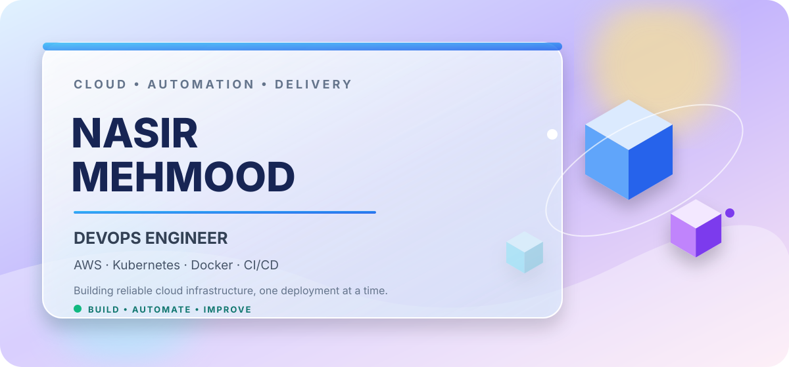
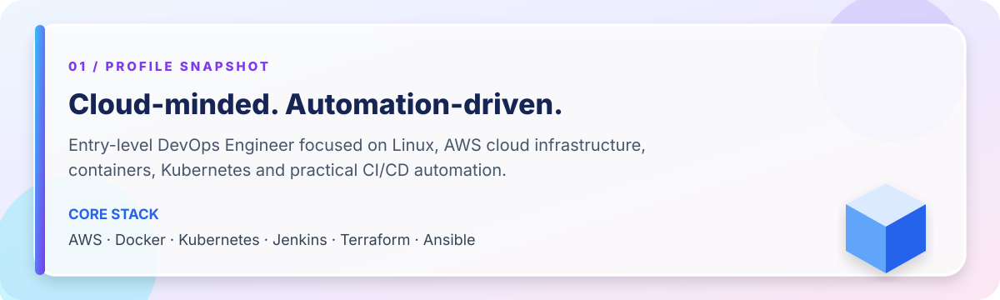
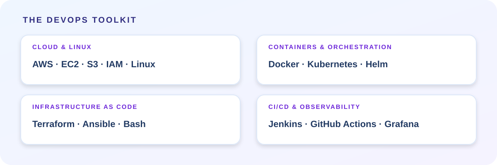
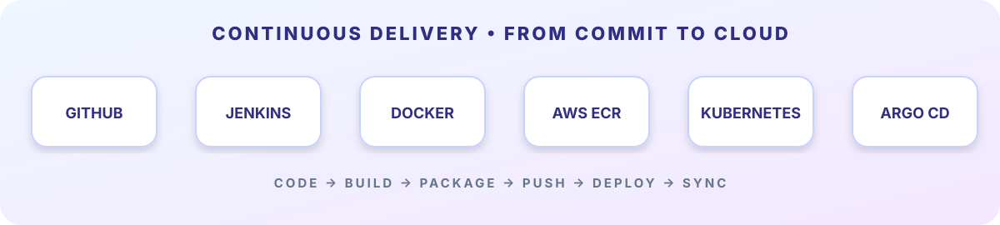
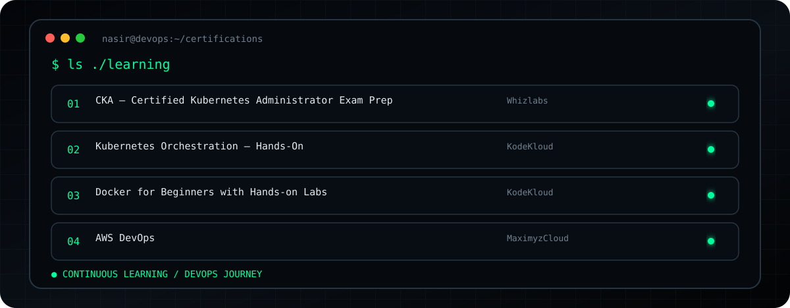
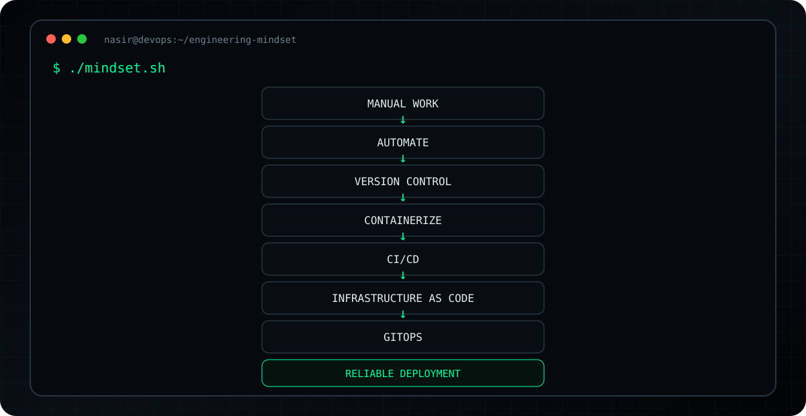

<!-- ═══════════════════════════════════════════════════════════════
     NASIR MEHMOOD • DEVOPS ENGINEERING PROFILE
     Pastel 3D glassmorphism • animated cloud-native portfolio
══════════════════════════════════════════════════════════════════ -->

 

  

 

**JUNIOR DEVOPS ENGINEER** &nbsp;•&nbsp; **AWS CLOUD** &nbsp;•&nbsp; **CLOUD-NATIVE SYSTEMS**

Designing repeatable deployments · Automating infrastructure · Learning through real-world builds

 

<table>
<tr>
<td width="58%" valign="top">

## ◈ THE ENGINEER

I'm **Nasir Mehmood** — a DevOps Engineer focused on building practical skills across cloud infrastructure, container platforms and delivery automation.

I enjoy understanding how systems work end-to-end: from provisioning infrastructure and packaging applications to deploying workloads and monitoring services.

- ☁️ Cloud infrastructure and AWS services
- 🐧 Linux administration and troubleshooting
- 🐳 Docker, Kubernetes and Helm
- 🔁 CI/CD with Jenkins and GitHub Actions
- 🧱 Infrastructure as Code with Terraform
- ⚙️ Configuration automation with Ansible
- 📊 Monitoring with Prometheus and Grafana
- 🎓 DevOps Internship — Mise Academy

</td>
<td width="42%" valign="top">

## ◈ CURRENT FOCUS

**Building toward**
- Production-ready cloud deployments
- Reliable Kubernetes workloads
- Secure infrastructure practices
- Observable delivery pipelines

**Based in** · Pakistan  
**Open to** · Junior DevOps · Cloud Support · Internships · Freelance

</td>
</tr>
</table>

---

## ◈ ENGINEERING TOOLKIT

<table>
<tr>
<td width="50%" valign="top">

**01 / CLOUD & SYSTEMS**

**02 / INFRASTRUCTURE AUTOMATION**

</td>
<td width="50%" valign="top">

**03 / CONTAINERS & PLATFORM**

**04 / DELIVERY & OBSERVABILITY**

</td>
</tr>
</table>

---

## ◈ DEPLOYMENT PIPELINE

| PLAN & CODE | BUILD & TEST | RELEASE & DEPLOY | OBSERVE & IMPROVE |
|:---:|:---:|:---:|:---:|
| Git · GitHub | Docker · Jenkins | Kubernetes · Helm · Argo CD | Prometheus · Grafana |

---

## ◈ SELECTED BUILDS

Hands-on repositories covering application delivery, containerization and cloud-native engineering.

<table>
<tr>
<td width="50%" valign="top">

### ☸️ EduConnect — MERN on Kubernetes

A containerized MERN application project focused on Kubernetes deployment resources and application exposure.

</td>
<td width="50%" valign="top">

### 🐳 Three-Tier App — Docker Compose

A multi-service application environment using Docker Compose and shared configuration.

</td>
</tr>
<tr>
<td width="50%" valign="top">

### 🤖 Kubernetes LLM App

Kubernetes-based application deployment and cloud-native experimentation.

</td>
<td width="50%" valign="top">

### 🍔 Food Delivery

Application repository with ongoing feature development and user-interface improvements.

</td>
</tr>
</table>

---

## ◈ GITHUB ACTIVITY

 

  

---

## ◈ LEARNING ROADMAP

| Focus | Direction |
|:---|:---|
| AWS | Cloud architecture, IAM, networking, compute and monitoring |
| Kubernetes | Workloads, networking, storage, Helm and cluster operations |
| IaC | Reusable Terraform modules and environment management |
| Automation | Ansible playbooks, Bash and Python scripting |
| GitOps | Argo CD and deployment automation |
| Observability | Prometheus, Grafana, metrics and troubleshooting |

---

## ◈ ENGINEERING PRINCIPLES

<table>
<tr>
<td align="center" width="25%">

**AUTOMATE**

Reduce repetitive work

</td>
<td align="center" width="25%">

**SECURE**

Build with access control in mind

</td>
<td align="center" width="25%">

**OBSERVE**

Measure and troubleshoot

</td>
<td align="center" width="25%">

**IMPROVE**

Learn and iterate continuously

</td>
</tr>
</table>

---

## ◈ LET'S BUILD SOMETHING

**Open to junior DevOps opportunities, cloud support roles, internships and collaborative projects.**

 

  

  

“Make it work. Make it reliable. Make it repeatable.”

**NASIR MEHMOOD** · DEVOPS ENGINEERING

